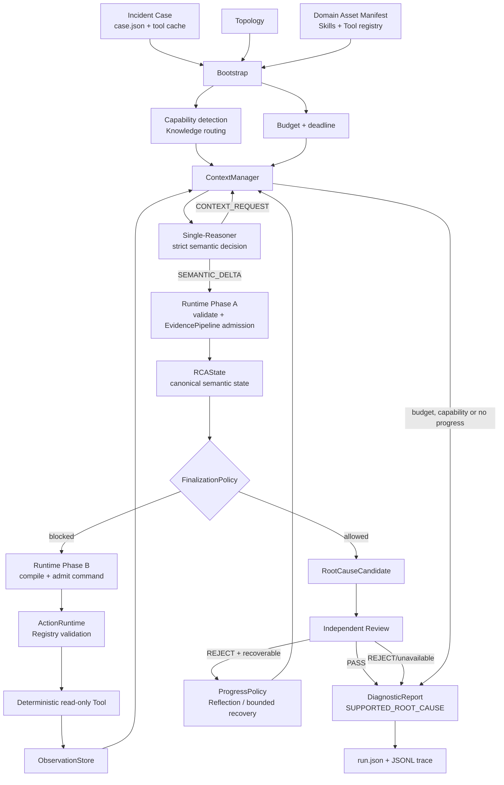

# 受证据约束的 CloudOps RCA Agent

一个面向 Kubernetes 和 Online Boutique 风格故障的根因分析 Agent。它把模型的语义推理与 Runtime 的确定性控制分开：模型决定调查方向、假设和证据含义；Runtime 管理状态、来源、工具、预算、因果准入和最终输出。

## 这个 Agent 做什么

一次诊断从故障现象和只读运行时快照开始，循环完成：

1. 读取当前诊断状态，选择 Skill 和下一步调查方向。
2. 通过确定性的只读 Tool 获取 Observation。
3. 将 Observation 解释为带来源的 Evidence，并关联到假设和验证要求。
4. 在因果证据充分时发布 `RootCauseCandidate`。
5. 由独立 Review 评估候选或未完成的诊断报告。

每次正常终止都会生成 `DiagnosticReport`。报告可以确认根因，也可以保留最可能的解释、证据链、未确认部分和后续调查建议。

## 整体架构



### 运行时职责

| 层 | 主要模块 | 责任 |
| --- | --- | --- |
| 入口与装载 | `cli.py`、`config.py`、`datasets/` | 读取配置、case、拓扑和资产 manifest，创建一次诊断运行 |
| 语义决策 | `agent/planner.py`、`agent/decision_surface.py`、`agent/decision_turn.py` | 用严格类型协议产生假设、Evidence 语义、验证问题和下一步意图 |
| 上下文 | `context/manager.py`、`context/projection.py` | 从 Incident、RCAState、Observation、Evidence、Tool 历史中构造角色视图；按需恢复原始内容 |
| 规范状态 | `incidents/rca_state.py`、`incidents/contracts.py`、`semantic_transition.py` | 保存假设修订、Canonical Question/CompletionContract、Evidence 关系和生命周期 |
| 采集与证据 | `tools/`、`action_runtime.py`、`memory/`、`evidence_pipeline.py` | 校验并执行合法命令，保存 Observation，将带 provenance 的语义证据准入唯一状态 |
| 控制策略 | `finalization.py`、`progress_policy.py`、`harness/` | 判断因果准入、限制重复和无进展、管理预算、超时、Provider 健康和恢复 |
| 输出与审查 | `report.py`、`agent/final_review.py` | 从已提交状态生成报告；Review 独立评估证据质量、推理和置信度 |

`RCAState` 是诊断语义的唯一权威。Observation 是 Tool 的原始结果，Evidence 是对 Observation 的语义解释；Evidence 必须保留到 Observation、文件或其他来源的 provenance。ContextManager 只负责构造可见视图，不拥有诊断语义。

## 一轮决策如何运行

### 1. ContextManager 构造当前视图

模型看到故障现象、当前假设、已提交的 Question/CompletionContract、已执行动作、Evidence 关系、工具反馈、可用 Skill、预算和必要的原始 Observation。完整内容按需恢复，常用状态以结构化摘要和来源引用传递。

### 2. Single-Reasoner 返回一种决策

模型通过严格的 `response_format=json_schema` 返回以下两类之一：

- `CONTEXT_REQUEST`：请求已保留的 Observation 或源码片段，不改变语义状态，也不执行 Tool。
- `SEMANTIC_DELTA`：提交假设转换、Evidence 解释、支持/反驳关系、Acknowledgement、新验证要求和一个 `next_action_intent`。

已有 Question 只能引用 Canonical requirement；新 Question 在同一决策中只声明一次。模型不生成 Runtime ID，也不决定生命周期是否生效。

### 3. Runtime Phase A 原子提交

Runtime 校验引用、假设生命周期、CompletionContract、Evidence 来源和关系，然后把语义增量一次性提交到 `RCAState`。失败时整次语义提交回滚。

### 4. FinalizationPolicy 判断是否足以发布候选

`FinalizationPolicy` 检查候选字段、直接因果支持、必要 CompletionContract、Required fact coverage、矛盾处理、源码覆盖和 fault taxonomy。它只读取 Canonical state，不接受模型自行声明的“已完成”。探索性问题不会单独阻塞终结；必要因果要求仍必须满足。

### 5. Runtime Phase B 执行下一步

如果尚不能终结，Runtime 根据已提交状态和实际 Registry 编译并准入 `next_action_intent`，校验工具、参数、目标、来源 profile 和 acquisition history，再由 `ActionRuntime` 执行确定性的只读 Tool。Tool 返回的 Observation 写入 `ObservationStore`，下一轮再由模型解释为 Evidence。

### 6. Review 与报告

候选发布后，独立 Review 只读取候选、已引用 Evidence、关系、矛盾和未验证部分，返回 `PASS` 或 `REJECT`、0～1 置信度及理由。Review 不能创建 Evidence，也不能放宽 Finalization。若调查因预算、能力或无进展结束而没有候选，在仍有 Review 资源且已有诊断材料时，Review 会审查 `INCONCLUSIVE` 报告；这不会把报告提升为已验证 RCA。

## 安装

需要 Python 3.11 或更高版本，以及一个 OpenAI 兼容 Provider 才能进行真实诊断。

```bash
python3 -m venv .venv
. .venv/bin/activate
python -m pip install -e '.[dev]'
cp .env.example .env
```

在 `.env` 中配置 Provider：

```dotenv
DEBUG_AGENT_PROVIDER=openai_compatible
DEBUG_AGENT_BASE_URL=https://api.openai.com/v1
DEBUG_AGENT_API_KEY=...
DEBUG_AGENT_MODEL=你的模型名
```

`DEBUG_AGENT_REFLECTION_MODEL` 和 `DEBUG_AGENT_CRITIC_MODEL` 可选；未配置时使用主模型。`mock` Provider 仅用于传输和资产 smoke，不执行语义诊断。

## 运行

一个 runtime case 至少包含：

```text
runtime-case/
├── case.json
├── tool_cache.json
├── raw_data/       # 可选：case 声明的运行时数据
└── code/           # 可选：源码证据
```

使用已配置的 Provider 运行：

```bash
debug-assistant run \
  --runtime-case /path/to/runtime-case \
  --manifest /path/to/DOMAIN_ASSET_MANIFEST.json \
  --topology /path/to/service_topology.json \
  --output /path/to/output
```

仓库中的 `examples/cloudops/` 提供可加载的 case、拓扑和 12 个 Skill 的 manifest，可用于检查输入格式：

```bash
python scripts/verify_public_release.py
```

运行结果写入：

```text
output/
├── run.json          # IncidentRunResult：状态、报告、候选、Review、证据和指标
└── traces/           # 有界 JSONL 运行 trace
```

CLI 返回码：`0` 表示 Review 通过的 RCA，`2` 表示已生成但未确认根因的 `INCONCLUSIVE`，`1` 表示运行时或 Provider 失败。

## 测试与开发

```bash
make smoke
make test
python -m compileall -q src scripts
python scripts/verify_public_release.py
```

`make smoke` 和默认测试不调用真实 Provider。需要外部 CloudOps 数据的测试通过 `external_dataset` 标记单独选择。`validate-protocol` 依赖完整开发检出版本中的版本化协议资产。

## 输入、输出与证据规则

- **Observation**：Tool 返回的原始、只读结果。
- **Evidence**：模型基于 Observation 给出的事实摘要、支持/反驳关系和与假设的关联。
- **CompletionContract**：描述必须验证哪些事实；由 Runtime 维护 Canonical identity。
- **Finalization**：只有必要事实覆盖、直接因果证据和矛盾处理都满足时才生成 `RootCauseCandidate`。
- **Review**：独立评估证据质量、因果逻辑、报告完整性和置信度；不会替代 Evidence 或 Finalization。

## 当前范围

当前发布版针对只读 CloudOps 快照和已注册的 Kubernetes/Online Boutique 诊断工具。真实运行需要单独提供 case、拓扑和领域资产。语义搜索、知识检索和 DAG 编排是可选能力，Runtime 的确定性状态和准入路径保持不变。
